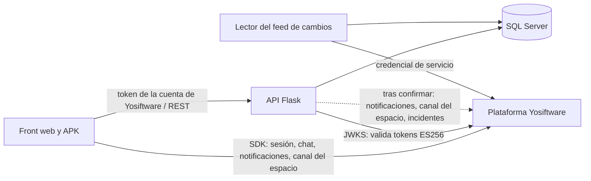

# Arquitectura del stack backend

Libros API es un backend Flask con SQL Server como fuente de verdad. Desde la fase 3 de la adhesión a Yosiftware, la cuenta, la sesión, el perfil, las relaciones, el chat, las notificaciones con su push y la moderación de cuentas son de la plataforma común; Libros valida sus tokens, sigue su feed de cambios y le envía lo que necesita mostrar.

## Componentes

| Componente | Responsabilidad | Entrada | Salida |
|---|---|---|---|
| API Flask | Dominio, permisos, REST, reset QA | HTTP con el token de la plataforma | SQL; tras confirmar, los puntos únicos hacia la plataforma |
| SQL Server | Estado autoritativo y auditable | consultas/transacciones | REST, lector del feed y snapshots QA |
| Lector del feed (`realtime/plataforma_feed_worker.py`) | Aplica `cuenta.*` y `perfil.*` a los usuarios locales; cursor en la misma transacción | feed de la plataforma (y su NATS, opcional) | `usuarios`, `plataforma_feed_cursor` |
| `utils/platform_notifications.py` | Las notificaciones de Libros (`notificar()`, `retirar()`) y su catálogo de tipos | controladores, tras confirmar; el catálogo, al arrancar | `PUT /v1/servicio/notificaciones/tipos`, `POST` y `DELETE /v1/servicio/notificaciones`, en segundo plano |
| `utils/platform_novedades.py` | Las novedades de lectura (estado, puntuación y reseña) y su catálogo de tipos | colección y moderación de reseñas, tras confirmar; el catálogo, al arrancar | `PUT /v1/servicio/novedades/tipos`, `POST` y `DELETE /v1/servicio/novedades`, en segundo plano |
| `utils/platform_dispatch.py` | El envío en segundo plano (un hilo por proceso, reintentos, lo último manda por `idExterno`) | los tres anteriores | cola en memoria |
| `utils/platform_yosiftware_news.py` | Las novedades de Yosiftware (`scripts/anunciar_novedad_yosiftware.py`) | a mano, al publicar en producción | `POST /v1/servicio/novedades/yosiftware` |
| `utils/platform_space_channel.py` | Los eventos `club.*` (`publicar()`) | clubes, tras confirmar | hoy solo registra; fase 4: canal del espacio |
| `utils/platform_moderation.py` | Los incidentes de moderación (`registrar_incidente()`, `casos()`) | la acción de administración que lo pida (hoy ninguna resolución lo hace) | `POST /v1/servicio/moderacion/incidentes`, en segundo plano |

El gateway WebSocket, el relay, el NATS propio, la proyección de Firestore, la RTDB, el push FCM y el worker de retención se retiraron (decisiones 4 a 7 de la petición de migración).

## Autoridad y recuperación

- SQL y REST son autoritativos; un aviso o un evento perdido se recupera pidiendo el recurso por REST.
- Las salidas hacia la plataforma se ejecutan solo después de confirmar la transacción (`utils/after_commit.py`); nunca se avisa de algo que se deshace.
- El feed de cambios guarda su cursor en la misma transacción que aplica los cambios.

## Entornos

| Entorno | Base SQL | Plataforma | Reset QA |
|---|---|---|---|
| `local` | desarrollo, normalmente `libros_pruebas` | la de QA (`https://qa-cuentas-api.yosiftware.es`) | no existe |
| `qa` | `libros_qa` | la de QA, con su credencial de servicio y sus cuentas de prueba | disponible con cuatro guards |
| `produccion` | `libros` | la de producción (`https://cuentas-api.yosiftware.es`) | ruta no registrada |

Los orígenes CORS se enumeran exactamente en `LIBROS_CORS_ALLOWED_ORIGINS`; no se aceptan comodines ni rutas. `/runtime-config` solo publica el entorno y la versión del dataset QA. Las credenciales de servicio, los tokens de reset y las credenciales SQL nunca se exponen.

QA publica la API mediante el túnel Cloudflare exclusivo `libros-qa`; SQL Server no se expone a Internet.

## Arranque

- Stack normal: `scripts/start-realtime-stack.ps1` (la API y el lector del feed).
- QA nativo: `qa/setup.ps1`, `qa/start.ps1`, `qa/status.ps1`, `qa/stop.ps1`.
- Smoke QA: `scripts/qa-smoke.ps1` (entorno, semáforo y perfiles) y `scripts/qa-plataforma-smoke.py` (cuentas de prueba de la plataforma).

La operación detallada está en `api/OPERACION.md`, `realtime/OPERACION.md` y `qa/README.md`.
